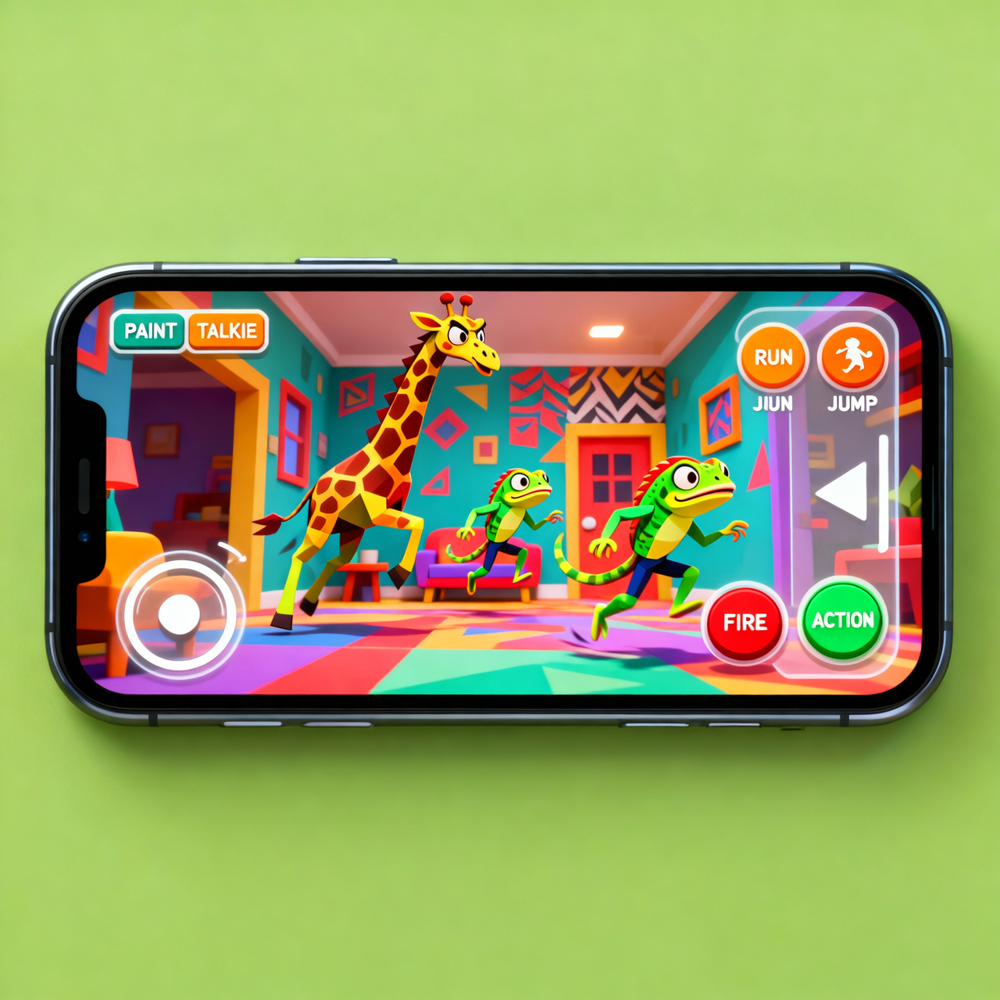

# 🐸 Meccha Frog — Android (Landscape Mobile Port)

  

  نسخة جوال أفقية كاملة الشاشة من لعبة <b>Meccha Frog Online</b> (Godot 4.7) 
  Full-screen landscape Android port of <b>Meccha Frog Online</b> (Godot 4.7)

  <a href="https://github.com/gggaa389-blip/meccha-frog-mobile/releases/latest"><b>⬇️ تحميل APK / Download the APK</b></a>
  ·
  <a href="docs/MOBILE_AR.md">📱 دليل الجوال (عربي)</a>
  ·
  <a href="docs/BUILD.md">🛠️ Build from source</a>

> الصورة أعلاه نموذج تصوري لتوزيع أزرار اللمس وليست لقطة من داخل اللعبة.
> The image above is a concept mockup of the touch layout, not an in-game screenshot.

## 📥 التثبيت / Install

1. حمّل `MecchaFrog.apk` من [آخر إصدار (Releases)](https://github.com/gggaa389-blip/meccha-frog-mobile/releases/latest).
2. فعّل «التثبيت من مصادر غير معروفة» للمتصفح/مدير الملفات عند الطلب.
3. ثبّت وشغّل — اللعبة أفقية وتملأ الشاشة تلقائياً.

1. Download `MecchaFrog.apk` from the [latest release](https://github.com/gggaa389-blip/meccha-frog-mobile/releases/latest).
2. Allow “Install unknown apps” for your browser/file manager if asked.
3. Install and play — the game runs in full-screen landscape.

## 📱 مواصفات APK / APK facts

| | |
|---|---|
| Package | `com.mecchafrog.game` |
| Version | `1.0.0-mobile` (versionCode 1) |
| Engine | Godot **4.7.2-stable**, GL Compatibility |
| Android | **7.0+** (minSdk 24), targetSdk 36 |
| CPU | **arm64-v8a only** (64-bit phones) |
| Orientation | `userLandscape` (Sensor Landscape in Godot) |
| APK size | `571 MiB (598,081,721 bytes)` |
| APK SHA-256 | `97b1a2c02f8958f6616d0dbb4c0835c0e69f76d19ffd403d76014a08dc026b7d` |
| Permissions | INTERNET, ACCESS_NETWORK_STATE, RECORD_AUDIO, VIBRATE |

## 🎮 التحكم باللمس / Touch controls

| على الشاشة / On screen | الوظيفة | Action |
|---|---|---|
| جويستك أسفل اليسار | الحركة | WASD (`forward/backwards/left/right`) |
| السحب على يمين الشاشة | الكاميرا | Mouse look (`mobile_look`) |
| FIRE | إطلاق / رمي | `fire` |
| USE | تفاعل | `action` (F) |
| JUMP | قفز | `jump` (Space) |
| RUN (اضغط مطولاً) | ركض | `run` (Shift) |
| PAINT / DONE | وضع الطلاء | `paint_mode` (E) |
| TALK | اللاسلكي | `talkie` (Q) |
| \| \| أعلى اليمين | إيقاف مؤقت | `escape` |

التحكم متعدد اللمس حقيقي: يمكنك التحرك بالجويستك وتدوير الكاميرا والضغط على زر في نفس اللحظة.
True multi-touch: joystick + camera + a button can be used at the same time.

## 🔧 ما الذي تغير عن نسخة الكمبيوتر؟ / What changed vs desktop?

- **أفقي بدون قص وبدون أطراف سوداء:** `stretch = canvas_items + expand` + `orientation = Sensor Landscape (4)` + وضع غامر (Immersive). الشاشات الأطول (19:9 / 20:9) ترى مجال رؤية أوسع بدل القص.
- **GL Compatibility** بدل Forward Plus ليعمل على معالجات رسوم الجوال (OpenGL ES 3). بعض مؤثرات Forward+ مثل SSIL تُعطَّل على الجوال.
- **تحكم لمس جديد بالكامل** في `assets/mobile/` يرسل نفس Input Actions الأصلية، ويظهر فقط على Android/iOS وللاعب المحلي فقط — نسخة الكمبيوتر لم تتغير.
- **Steam معطل على الجوال** (تهيئة/تنبيهات/صوت Steam) لأنه لا يوجد Steam على الهواتف. اللعب الجماعي على الجوال يستخدم **ENet**.
- إصلاح انضمام ENet لاستخدام العنوان المكتوب في القائمة (IP المضيف على نفس الواي فاي، مثل `192.168.1.20` أو `192.168.1.20:8008`) بدل `127.0.0.1` الدائم.
- كل التعديلات داخل الكود موسومة بتعليق `# [Mobile APK]` لسهولة مراجعتها.

Details (Arabic): [docs/MOBILE_AR.md](docs/MOBILE_AR.md) · Build steps: [docs/BUILD.md](docs/BUILD.md)

## 🌐 اللعب مع صديق على نفس الشبكة / LAN play (ENet)

1. المضيف: من القائمة اختر نوع السيرفر **ENet** ثم **Create**، ثم ابدأ اللعبة من اللوبي.
2. اعرف IP المضيف على الواي فاي (من إعدادات الواي فاي في هاتفه).
3. اللاعب الثاني: اكتب الـ IP في خانة `LOBBY ID HERE` ثم **Join**.

> Steam lobbies and Steam voice chat remain desktop-only in this port.

## 🏗️ البناء من المصدر / Build

افتح المشروع بـ **Godot 4.7.2** ثم `Project → Export → Android`.
التفاصيل الكاملة (JDK 17 + Android SDK + التوقيع): [docs/BUILD.md](docs/BUILD.md).
يوجد قالب Workflow يدوي جاهز في `docs/github-workflow/build-android.yml` — انسخه إلى `.github/workflows/build-android.yml` في مستودعك لتفعيل البناء السحابي.

## 🙏 Credits & License

Original project © 2025 **reckdave**, released under the **MIT License** — see [LICENSE](LICENSE).
Android conversion, touch controls and build setup were added on top of that original work; the original license and copyright notice are preserved.

هذا المشروع تحويل للجوال من المشروع الأصلي المرخص MIT مع الحفاظ على إشعار الحقوق الأصلي.
